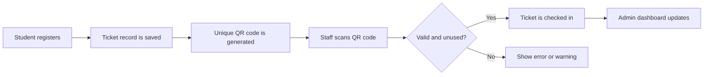

# TicketHive

TicketHive is a college event management system made with Flask. It lets students discover college events, register online, receive a QR ticket, and check in at the event. Administrators can manage events, scan tickets, and view attendance reports.

## What the project can do

### Student features

- Create a student account and log in.
- Browse, search, and filter events.
- View complete event details, including the venue map link.
- Register once for an event while seats are available.
- View a personal QR ticket for every registration.
- Print or save a ticket as a PDF from the browser.
- Cancel a registration before check-in.

### Administrator features

- Create, edit, and remove events.
- Add an event image and a Google Maps location link.
- Open a QR scanner for a selected event.
- Check in each valid ticket only once.
- View total events, registrations, check-ins, remaining attendees, progress bars, and charts.
- Download a CSV attendance report for each event.

## How the system works



## Project folders

| Folder or file | Purpose |
| --- | --- |
| `app.py` | Starts Flask, connects the database, registers all modules, and contains the `create-admin` command. |
| `models.py` | Defines the User, Event, and Ticket database tables. |
| `auth/` | Registration, login, and logout code. |
| `events/` | Event list, search, filtering, details, create, edit, and delete code. |
| `tickets/` | Student registration, ticket display, cancellation, and QR code generation. |
| `scanner/` | QR scanning page and ticket verification API. |
| `admin/` | Admin dashboard and CSV attendance export. |
| `templates/` | HTML pages shown in the browser. |
| `static/` | CSS, JavaScript, uploaded event pictures, and theme styling. |
| `instance/ticketing.sqlite3` | Local SQLite database, created automatically after the app runs. |

## Database tables

| Table | Stores |
| --- | --- |
| `users` | Student and administrator accounts. |
| `events` | Event title, description, department, date, location, capacity, image, and creator. |
| `tickets` | A student's event registration, QR token, and check-in status. |

One student can have many tickets. One event can have many tickets. A student can register only once for the same event.

## Run the project

### 1. Create and activate a virtual environment

```bash
python -m venv .venv
source .venv/bin/activate
```

On Windows PowerShell:

```powershell
.venv\Scripts\Activate.ps1
```

### 2. Install packages

```bash
pip install -r requirements.txt
```

### 3. Set environment values

```bash
cp .env.example .env
```

Open `.env` and set a private `SECRET_KEY`. Do not upload `.env` to GitHub.

### 4. Start the application

```bash
flask --app app run --debug
```

Open the local address shown in the terminal, normally `http://127.0.0.1:5000`.

## Create an administrator account

Run this command in another terminal while the virtual environment is active:

```bash
flask --app app create-admin
```

Enter the administrator name, email, and password when asked. Public registration always creates a student account, so students cannot make themselves administrators.

## How to demonstrate the project

1. Log in as an administrator and create an event.
2. Log out and register a student account.
3. Search for the event, open its details page, and register.
4. Open **My tickets** to show the QR event pass.
5. Log in as the administrator, open the event scanner, and scan the QR code.
6. Open **Admin Dashboard** to show the check-in total, chart, and CSV export.

## Main routes

| URL | Purpose |
| --- | --- |
| `/events` | Browse, search, and filter events. |
| `/events/<event_id>` | View one event in detail. |
| `/my-tickets` | View a logged-in student's tickets. |
| `/scanner/<event_id>` | Open the administrator QR scanner. |
| `/admin/dashboard` | Open administrator analytics. |
| `/admin/events/new` | Create an event as an administrator. |

## Important notes

- QR scanning needs camera permission from the browser.
- A phone camera generally needs `https://` when the app is deployed online. `localhost` works for local development.
- Event images are stored in `static/uploads/`.
- The database is local to the project at `instance/ticketing.sqlite3`.
- Use an administrator account you create yourself; do not store real passwords in source files or GitHub.

Login details:
- Email: admin@college.local
- Password: CollegeAdmin@2026!
